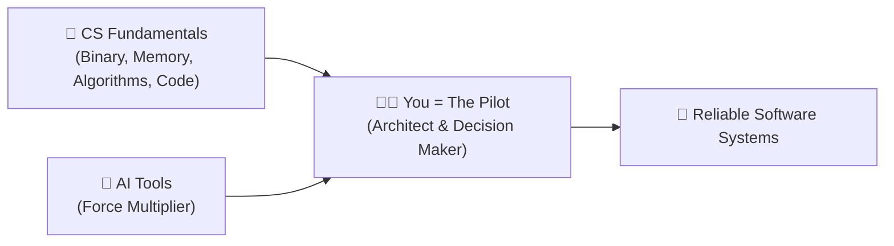

# 🚀 Week 0 (Part 1) — Welcome, AI & Your First Python Chatbot (`chat.py`)

> **Navigation:** [🏠 Week 0 Table of Contents](./00_Table_of_Contents.md) · **Next ➡️** [02 — Binary, Bits & Bytes](./02_Binary_Bits_and_Bytes.md)  
> **Lecture Window:** [`00:00` – `14:25`](https://video.cs50.io/UuIEbpQms8o?start=0) · **Status:** ✅ Completed

---

## 1. AI Does Not Replace Fundamentals — It Makes You the Pilot ([02:25](https://video.cs50.io/UuIEbpQms8o?start=145))

David Malan opens CS50x by addressing why learning **Computer Science** from the ground up matters more than ever in the age of Artificial Intelligence:

- **Eliminating Bottlenecks:** AI removes human bottlenecks and accelerates code generation, but if you do not understand how software works under the hood, you are merely a passenger.
- **Becoming the Pilot:** Mastering CS fundamentals puts you in the **driver's seat ("the pilot")**. Instead of hoping an AI generates the right thing, you understand, architect, organize, and debug systems yourself—using AI as a force multiplier.



---

## 2. Live Demo: Visual Studio Code + OpenAI API (`chat.py`) ([04:48](https://video.cs50.io/UuIEbpQms8o?start=288))

Before diving into zeros and ones, Malan previews what you will be able to write in just a few weeks using **Visual Studio Code** (an **IDE** — *Integrated Development Environment*, combining a text editor and a terminal) and OpenAI's **API** (*Application Programming Interface*).

### Evolution 1 — Hardcoded Prompt ([05:20](https://video.cs50.io/UuIEbpQms8o?start=320))
A 7-line program that imports OpenAI's library, sends a fixed question to `gpt-5`, and prints the answer:

```python
from openai import OpenAI

client = OpenAI()

response = client.responses.create(
    input="In one sentence, what is CS50?",
    model="gpt-5"
)

print(response.output_text)
```

### Evolution 2 — Interactive `input()` Variable ([08:26](https://video.cs50.io/UuIEbpQms8o?start=506))
Instead of hardcoding the question, we ask the user in the terminal using `input("Prompt: ")` and store their answer inside a **variable** named `prompt`:

```python
from openai import OpenAI

client = OpenAI()

prompt = input("Prompt: ")

response = client.responses.create(
    input=prompt,
    model="gpt-5"
)

print(response.output_text)
```

### Evolution 3 — Adding a `system_prompt` ([10:36](https://video.cs50.io/UuIEbpQms8o?start=636))
Finally, we steer the AI's behavior and personality by passing `instructions=system_prompt`:

```python
from openai import OpenAI

client = OpenAI()

user_prompt = input("Prompt: ")
system_prompt = "Limit your answer to one sentence. Pretend you're a cat."

response = client.responses.create(
    input=user_prompt,
    instructions=system_prompt,
    model="gpt-5"
)

print(response.output_text)
```

| Concept in `chat.py` | Role in the Program |
| :--- | :--- |
| `from openai import OpenAI` | Imports third-party code (a **library**) written by OpenAI engineers so we don't reinvent the wheel. |
| `input("Prompt: ")` | Pauses the program in the terminal, waits for human keyboard input, and returns that text. |
| `user_prompt` / `system_prompt` | **Variables** that store text in memory so we can pass them into functions. |
| `client.responses.create(...)` | Calls OpenAI's **API** over the internet and returns the generated response. |

---

## 3. Rubber Duck Debugging & `cs50.ai` ([12:30](https://video.cs50.io/UuIEbpQms8o?start=750))

> [!IMPORTANT]
> **What is *Rubber Duck Debugging*?**  
> When programmers get stuck on a bug and don't have a colleague nearby, a classic technique is to keep a **rubber duck** on the desk and explain the code to it **out loud, line by line**. Hearing yourself state what the code *should* do vs. what you actually wrote forces your brain to spot the logical contradiction.
>
> **CS50x Academic Honesty Policy:**  
> - ❌ **Not Allowed:** Using general external AI tools (ChatGPT, Gemini, Claude, GitHub Copilot) to solve CS50 problem sets.  
> - ✅ **Allowed & Encouraged:** Using Harvard's official AI rubber duck at [**`cs50.ai` (CS50 Duck)**](https://cs50.ai/) or inside [`cs50.dev`](https://cs50.dev/), which is trained to guide you like a teaching fellow without handing you the finished solution.

---

> **Navigation:** [🏠 Week 0 Table of Contents](./00_Table_of_Contents.md) · **Next ➡️** [02 — Binary, Bits & Bytes](./02_Binary_Bits_and_Bytes.md)
