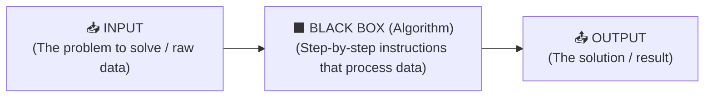

# 🔢 Week 0 (Part 2) — Binary, Bits, Transistors & Bytes

> **Navigation:** **⬅️ Prev:** [01 — Intro, AI & `chat.py`](./01_Intro_AI_and_ChatPy.md) · [🏠 Week 0 Table of Contents](./00_Table_of_Contents.md) · **Next ➡️** [03 — ASCII, Unicode & RGB](./03_ASCII_Unicode_and_RGB.md)  
> **Lecture Window:** [`14:27` – `29:54`](https://video.cs50.io/UuIEbpQms8o?start=867) · **Status:** ✅ Completed

---

## 1. Computer Science & Computational Thinking ([14:27](https://video.cs50.io/UuIEbpQms8o?start=867))

At [`14:27`](https://video.cs50.io/UuIEbpQms8o?start=867), David Malan defines the two foundational pillars of the course:

- **Computer Science:** **The study of information** — how do you represent it, and how do you process it?
- **Computational Thinking:** The application of ideas from computer science to solve problems of interest in the real world.

### The Universal Problem-Solving Model (`Input → Algorithm → Output`) ([14:59](https://video.cs50.io/UuIEbpQms8o?start=899))

Every computational problem boils down to taking an **input**, processing it through a series of step-by-step instructions (an **algorithm** inside a "black box"), and producing an **output**:

> [!NOTE]
> **The First Big Question:** Before we can feed an `INPUT` into a computer or get an `OUTPUT` back, **how do we agree to represent information (numbers, letters, colors, images, video, audio) inside a machine that only has electricity?**

---

## 2. Unary (`Base-1`) vs. Binary (`Base-2`), Bits & Transistors (`15:39` – `21:31`)

### 2.1. Unary Notation (`Base-1`) — Counting on Human Fingers ([15:39](https://video.cs50.io/UuIEbpQms8o?start=939))
When humans count on one hand the traditional way, we use **unary notation (`Base-1`)**:
- There is only **one symbol** (a raised finger = $+1$).
- With **5 fingers** on one hand, you can only count up to **`5`** (`1, 2, 3, 4, 5`), because order does not matter—each finger always adds `1`.

### 2.2. Binary System (`Base-2`) — Counting by Patterns ([16:09](https://video.cs50.io/UuIEbpQms8o?start=969))
If instead of treating every finger as $+1$, we account for the **exact positional pattern of which fingers are down (`0`) and which fingers are up (`1`)**, we switch to the **binary system (`Base-2`)**:
- Using the exact same **5 fingers** on one hand, you can count from **`0` all the way up to `31`** ($2^5 = 32$ distinct patterns)!

| Counting System | Base | Symbols Used | Max Value with 5 Fingers |
| :--- | :---: | :---: | :---: |
| **Unary Notation** | `Base-1` | `1` symbol (tally mark / finger) | **`5`** |
| **Binary System** | `Base-2` | `2` symbols (`0` and `1`) | **`31`** ($32$ total states including `0`) |

### 2.3. What is a `Bit` & Why Do Computers Use `Transistors`? ([17:49](https://video.cs50.io/UuIEbpQms8o?start=1069) – [19:27](https://video.cs50.io/UuIEbpQms8o?start=1167))

- **`Bit` = `Bi`nary Digi`t`:** The smallest unit of information in a computer. A single bit can only hold one of two values: **`0`** or **`1`**.
- **Why only `0` and `1` instead of `0` through `9`?**  
  Because computers run on **electricity** (electrons flowing from a wall outlet or battery). Physically, it is much easier and more reliable for hardware to distinguish between two extreme electrical states: **electricity is NOT flowing (`OFF = 0`)** vs. **electricity IS flowing (`ON = 1`)**.
- **The Light Bulb Analogy & `Transistors` ([19:27](https://video.cs50.io/UuIEbpQms8o?start=1167)):**
  > *"Computers don't have little light bulbs inside, but they have millions (and billions) of tiny little things called **transistors**."*  
  Inside your CPU, RAM, and phone are billions of microscopic silicon switches called **transistors**:

| Physical Transistor State | Light Bulb Metaphor | Bit Value |
| :---: | :---: | :---: |
| **No charge / Switch Open** | ⚫ `OFF` | **`0`** |
| **Charge flowing / Switch Closed** | 💡 `ON` | **`1`** |

---

## 3. Positional Math: Decimal (`Base-10`) vs. Binary (`Base-2`) (`21:32` – `26:25`)

A single light bulb (`1 bit`) can only represent two states: `0` (⚫) or `1` (💡). To count higher (`2, 3, 4, 7...`), we group multiple bits together and assign a **positional weight** to each column—just like we do in everyday math.

### 3.1. How Humans Count: The Decimal System (`Base-10`) ([21:32](https://video.cs50.io/UuIEbpQms8o?start=1292) – [23:00](https://video.cs50.io/UuIEbpQms8o?start=1380))
In the **decimal system (`Base-10`)**, we have **10 digits (`0` → `9`)**.  
When you see the symbols `123`, you immediately read it as *one hundred twenty-three* because each column represents a **power of 10** ($10^2, 10^1, 10^0$):

| Power of 10 | $10^2$ *(Hundreds)* | $10^1$ *(Tens)* | $10^0$ *(Ones)* | Positional Math |
| :---: | :---: | :---: | :---: | :--- |
| **Column Weight** | **`100`** | **`10`** | **`1`** | |
| **Digits of `123`** | `1` | `2` | `3` | $(100 \times 1) + (10 \times 2) + (1 \times 3) = \mathbf{123}$ |

### 3.2. How Computers Count: The Binary System (`Base-2`) ([23:42](https://video.cs50.io/UuIEbpQms8o?start=1422))
Computers use the **exact same positional math**, except because they only have **2 symbols (`0` and `1`)**, their columns use **powers of 2** ($2^2, 2^1, 2^0 \dots$) instead of powers of 10:

| Power of 2 | $2^2$ | $2^1$ | $2^0$ |
| :---: | :---: | :---: | :---: |
| **Column Weight** | **`4`** | **`2`** | **`1`** |

Here is how **3 light bulbs (`3 bits`)** represent every number from **`0` to `7`**:

| `4` Place ($2^2$) | `2` Place ($2^1$) | `1` Place ($2^0$) | 3 Light Bulbs | Positional Addition | Decimal Value |
| :---: | :---: | :---: | :---: | :--- | :---: |
| `0` | `0` | `0` | ⚫ ⚫ ⚫ | $0 + 0 + 0$ | **`0`** |
| `0` | `0` | `1` | ⚫ ⚫ 💡 | $0 + 0 + 1$ | **`1`** |
| `0` | `1` | `0` | ⚫ 💡 ⚫ | $0 + 2 + 0$ | **`2`** |
| `0` | `1` | `1` | ⚫ 💡 💡 | $0 + 2 + 1$ | **`3`** |
| `1` | `0` | `0` | 💡 ⚫ ⚫ | $4 + 0 + 0$ | **`4`** |
| `1` | `0` | `1` | 💡 ⚫ 💡 | $4 + 0 + 1$ | **`5`** |
| `1` | `1` | `0` | 💡 💡 ⚫ | $4 + 2 + 0$ | **`6`** |
| `1` | `1` | `1` | 💡 💡 💡 | $4 + 2 + 1$ | **`7`** *(Max with 3 bits)* |

### 3.3. What If You Want to Count to `8`? (Adding a 4th Bit vs. *Overflow*) ([25:26](https://video.cs50.io/UuIEbpQms8o?start=1526))
- With 3 bits all turned `ON` (`111`), the highest number you can reach is **`7`**, giving **$8$ total combinations** ($2^3 = 8$, counting `0` through `7`).
- To represent **`8`**, you need a 4th bit on the left ($2^3 = 8$), written as **`1000`** ($8 + 0 + 0 + 0 = 8$).
- ⚠️ **Integer Overflow Bug:** If a program only allocates **3 bits of memory** and tries to add $+1$ to `7` (`111`), there is nowhere to store the `1` in the `8`s column—so the 3 bits wrap all the way back around to **`000` (`0`)**!

---

## 4. The `Byte` (`8 Bits`) & The `256` Limit (`26:26` – `29:54`)

Because a single bit (or even 3 bits) is too small to be useful on its own, computers standardize memory around the **Byte**:

$$\mathbf{1\text{ Byte} = 8\text{ Bits}}$$

### 4.1. Visual Grid of 1 Byte (The 8 Powers-of-2 Columns)
A single byte has **8 bit positions**, weighted from $2^0 = 1$ (rightmost) to $2^7 = 128$ (leftmost):

| Power of 2 | $2^7$ | $2^6$ | $2^5$ | $2^4$ | $2^3$ | $2^2$ | $2^1$ | $2^0$ | Decimal Total |
| :--- | :---: | :---: | :---: | :---: | :---: | :---: | :---: | :---: | :---: |
| **Place Value** | **`128`** | **`64`** | **`32`** | **`16`** | **`8`** | **`4`** | **`2`** | **`1`** | — |
| **Minimum (`All OFF`)** | `0` | `0` | `0` | `0` | `0` | `0` | `0` | `0` | **`0`** |
| **Example: Number `5`** | `0` | `0` | `0` | `0` | `0` | `1` | `0` | `1` | **`5`** ($4 + 1$) |
| **Maximum (`All ON`)** | `1` | `1` | `1` | `1` | `1` | `1` | `1` | `1` | **`255`** ($128+64+32+16+8+4+2+1$) |

### 4.2. The Golden Rule: Why `8 Bits = 256 (2^8)` Possibilities ([27:11](https://video.cs50.io/UuIEbpQms8o?start=1631) – [27:42](https://video.cs50.io/UuIEbpQms8o?start=1662))

> [!IMPORTANT]
> **Why is the maximum number in 1 Byte `255`, if $2^8 = 256$?**  
> - Because computers start counting at **`0`** (`00000000`), not `1`!
> - Formula for **$n$ bits**:
>   - **Total possible patterns:** $2^n$
>   - **Highest positive integer (starting from 0):** $2^n - 1$
> - **Common Hardware Sizes:**
>   - **3 bits:** $2^3 = \mathbf{8}$ possibilities (`0` to `7`).
>   - **8 bits (1 Byte):** $2^8 = \mathbf{256}$ possibilities (`0` to `255`).
>   - **32 bits (4 Bytes):** $2^{32} \approx \mathbf{4\text{ billion}}$ possibilities (`4,294,967,296`).
>   - **64 bits (8 Bytes):** $2^{64} \approx \mathbf{1.84 \times 10^{19}}$ possibilities.

---

## 🎯 Quick Self-Check (`Flash Review`)

<b>1. What decimal number does the byte <code>00001011</code> represent?</b> <i>(Click to reveal)</i>

Looking at the last four columns (`8 | 4 | 2 | 1`), the `8`, `2`, and `1` bits are turned `ON` (`1`) $\rightarrow$ $8 + 2 + 1 = \mathbf{11}$.

<b>2. Why does 1 Byte have 256 combinations if its highest value is 255?</b> <i>(Click to reveal)</i>

Because one of the $2^8 = 256$ combinations is used to represent **`0`** (`00000000`). Counting from `0` through `255` gives $256$ total values.

<b>3. What is the difference between a Bit and a Transistor?</b> <i>(Click to reveal)</i>

A **Transistor** is the physical hardware switch inside the silicon chip that lets electricity flow (`ON`) or blocks it (`OFF`). A **Bit** (`0` or `1`) is the logical unit of information represented by that transistor's state.

---

> **Navigation:** **⬅️ Prev:** [01 — Intro, AI & `chat.py`](./01_Intro_AI_and_ChatPy.md) · [🏠 Week 0 Table of Contents](./00_Table_of_Contents.md) · **Next ➡️** [03 — ASCII, Unicode & RGB](./03_ASCII_Unicode_and_RGB.md)
