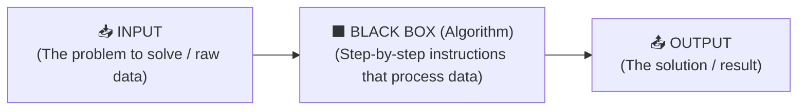

# 🎓 CS50x 2026 — Week 0: Scratch & Computational Thinking

> **Instructor:** David J. Malan (Harvard University)  
> **Last Session:** `08/10/2026` · **Current Progress:** `00:00` → [`29:54` (`start=1794`)](https://video.cs50.io/UuIEbpQms8o?start=1794) *(Paused right at the start of **ASCII**)*  
> **Quick Links:** [📺 Resume Lecture at 29:54](https://video.cs50.io/UuIEbpQms8o?start=1794) · [📄 Official Lecture 0 Notes](https://cs50.harvard.edu/x/2026/notes/0/) · [🧩 Problem Set 0](https://cs50.harvard.edu/x/2026/psets/0/)

---

## ⚡ Live Quick-Capture Inbox (Your Raw Keywords)

> [!TIP]
> **Fast Note-Taking Workflow:** While watching the lecture, **do not waste time formatting tables or writing long definitions**. Just drop your raw keywords, short phrases, or timestamps right below. When you finish your session, tell Tyler *"Format today's notes"* to automatically expand both the **Table of Contents** and the **Visual Study Chapters** below.

- *(Drop your next raw keywords here starting from minute `29:54` — ASCII, Unicode, RGB, Algorithms...)*
- 

---

## 📑 1. Table of Contents & Master Glossary (`00:00` → `29:54`)

### Visual Notebook Chapters
1. [🚀 Chapter 1: Welcome, AI & Your First Python Chatbot (`00:00` – `14:25`)](#-chapter-1-welcome-ai--your-first-python-chatbot-0000--1425)
2. [🧠 Chapter 2: Computer Science & Computational Thinking (`14:27` – `15:38`)](#-chapter-2-computer-science--computational-thinking-1427--1538)
3. [✋ Chapter 3: Unary (`Base-1`) vs. Binary (`Base-2`), Bits & Transistors (`15:39` – `21:31`)](#-chapter-3-unary-base-1-vs-binary-base-2-bits--transistors-1539--2131)
4. [🔢 Chapter 4: Positional Math — Decimal (`Base-10`) vs. Binary (`Base-2`) (`21:32` – `26:25`)](#-chapter-4-positional-math--decimal-base-10-vs-binary-base-2-2132--2625)
5. [📦 Chapter 5: The `Byte` (`8 Bits`) & The `256` Limit (`26:26` – `29:54`)](#-chapter-5-the-byte-8-bits--the-256-limit-2626--2954)
6. [🎯 Quick Self-Check (`Flash Review 00:00 → 29:54`)](#-quick-self-check-flash-review-0000--2954)

### Master Concept Table & Timestamps

| Content / Term | Meaning (Core Definition) | Video Timestamp |
| :--- | :--- | :---: |
| **AI & Fundamentals** | AI removes human bottlenecks, but mastering CS fundamentals keeps you in the **driver's seat ("the pilot")**. | [02:25](https://video.cs50.io/UuIEbpQms8o?start=145) |
| **IDE (`VS Code`)** | *Integrated Development Environment*: the workspace (code editor + terminal) where programmers write and run code. | [04:48](https://video.cs50.io/UuIEbpQms8o?start=288) |
| **API** | *Application Programming Interface*: mechanism to connect your code to external services (such as OpenAI's `gpt-5`). | [06:23](https://video.cs50.io/UuIEbpQms8o?start=383) |
| **Rubber Duck Debugging** | Verbalizing your code line by line to a rubber duck (`cs50.ai`) to spot your own logical bugs. | [12:30](https://video.cs50.io/UuIEbpQms8o?start=750) |
| **Computer Science** | **The study of information** — how to represent it and how to process it — applied to problem-solving. | [14:27](https://video.cs50.io/UuIEbpQms8o?start=867) |
| **Computational Thinking** | Applying ideas from computer science to solve real-world problems methodically. | [14:31](https://video.cs50.io/UuIEbpQms8o?start=871) |
| **Unary Notation (`Base-1`)** | Counting system with only **1 symbol** (e.g., human fingers where each raised finger simply adds $+1$). | [15:39](https://video.cs50.io/UuIEbpQms8o?start=939) |
| **Binary System (`Base-2`)** | Positional counting system with **2 digits (`0` and `1`)**, mapping directly to electricity (`OFF` and `ON`). | [16:09](https://video.cs50.io/UuIEbpQms8o?start=969) |
| **Bit (`Binary Digit`)** | Portmanteau of **bi**nary digi**t**: a single `0` or `1` (the smallest unit of information in computing). | [17:49](https://video.cs50.io/UuIEbpQms8o?start=1069) |
| **Transistors** | Microscopic physical switches inside CPUs/memory (millions/billions of "tiny light bulbs") that turn `ON` (`1`) or `OFF` (`0`). | [19:27](https://video.cs50.io/UuIEbpQms8o?start=1167) |
| **Decimal System (`Base-10`)** | Human counting system with **10 digits (`0` → `9`)** using powers of 10 ($10^0, 10^1, 10^2 \dots$). | [21:32](https://video.cs50.io/UuIEbpQms8o?start=1292) / [23:00](https://video.cs50.io/UuIEbpQms8o?start=1380) |
| **Binary Powers ($2^n$)** | Positional columns in Base-2 use **powers of 2** ($2^0=1,\, 2^1=2,\, 2^2=4,\, 2^3=8 \dots$) because there are only 2 symbols. | [23:42](https://video.cs50.io/UuIEbpQms8o?start=1422) |
| **Integer Overflow (3 bits)** | Running out of bits: if you only have 3 bits (max `111` = $7$) and try to store `8` (`1000`), the 3 bits roll back to `000`. | [25:26](https://video.cs50.io/UuIEbpQms8o?start=1526) |
| **Byte (`8 Bits`)** | Standard unit of **8 bits grouped together** ($1\text{ Byte} = 8\text{ Bits}$). | [26:26](https://video.cs50.io/UuIEbpQms8o?start=1586) |
| **$8\text{ Bits} = 2^8 = 256$** | One byte (`8 bits`) represents **$256$ total possibilities**: from `0` (`00000000`) up to `255` (`11111111`). | [27:11](https://video.cs50.io/UuIEbpQms8o?start=1631) / [27:42](https://video.cs50.io/UuIEbpQms8o?start=1662) |

---
---

# 📖 2. Visual Study Notebook (Lecture 0 — Step by Step)

---

## 🚀 Chapter 1: Welcome, AI & Your First Python Chatbot (`00:00` – `14:25`)

### 1.1. AI Does Not Replace Fundamentals — It Makes You the Pilot ([02:25](https://video.cs50.io/UuIEbpQms8o?start=145))
David Malan opens the course by addressing why learning **Computer Science** from scratch matters more than ever in the age of Artificial Intelligence:
- AI eliminates **human bottlenecks**, making code generation faster, but if you don't understand how software works under the hood, you are just a passenger.
- Mastering the fundamentals makes you **the driver, the pilot, an empowered creator**: you use AI as a force multiplier while remaining in full control of the architecture and logic.

### 1.2. Live Demo: VS Code + OpenAI API in 10 Lines (`chat.py`) ([04:48](https://video.cs50.io/UuIEbpQms8o?start=288))
To give a preview of what you will be able to build later in the course, Malan opens **Visual Studio Code** (an **IDE** — *Integrated Development Environment*) and writes a Python script (`chat.py`) that connects to OpenAI's **API** (*Application Programming Interface*) in two quick evolutions:

#### Step A — Hardcoded Prompt
```python
from openai import OpenAI

client = OpenAI()

response = client.responses.create(
    input="In one sentence, what is CS50?",
    model="gpt-5"
)

print(response.output_text)
```

#### Step B — Dynamic `user_prompt` + `system_prompt` ([08:26](https://video.cs50.io/UuIEbpQms8o?start=506) – [10:36](https://video.cs50.io/UuIEbpQms8o?start=636))
By adding `input("Prompt: ")`, the program waits for the user's question in the terminal, and `system_prompt` instructs the model how to behave:

```python
from openai import OpenAI

client = OpenAI()

user_prompt = input("Prompt: ")
system_prompt = "Limit your answer to one sentence. Pretend you're a cat."

response = client.responses.create(
    input=user_prompt,
    instructions=system_prompt,
    model="gpt-5"
)

print(response.output_text)
```

### 1.3. Rubber Duck Debugging & `cs50.ai` ([12:30](https://video.cs50.io/UuIEbpQms8o?start=750))
> [!IMPORTANT]
> **What is *Rubber Duck Debugging*?**  
> In software engineering, when you hit a bug and don't have a colleague nearby, you place a **rubber duck** on your desk and explain your code to it out loud, line by line. Verbalizing what your code *actually* does (versus what you *think* it does) forces your brain to catch the logic flaw.
>
> **CS50x Academic Honesty Rule:** Using external AI tools (ChatGPT, Gemini, Claude, Copilot) to solve CS50 problem sets is **not allowed**, but using Harvard's official AI tutor [**`cs50.ai` (CS50 Duck)**](https://cs50.ai/) is **100% allowed and encouraged**.

---

## 🧠 Chapter 2: Computer Science & Computational Thinking (`14:27` – `15:38`)

At [`14:27`](https://video.cs50.io/UuIEbpQms8o?start=867), Malan defines the core concepts of the entire course:

- **Computer Science:** **The study of information** — how do you represent it, and how do you process it?
- **Computational Thinking:** The application of ideas from computer science to solve problems of interest in the real world.

### The Universal Problem-Solving Model (`Input → Algorithm → Output`) ([14:59](https://video.cs50.io/UuIEbpQms8o?start=899))

Every computational problem boils down to three components:



> [!NOTE]
> **The First Big Question:** Before we can feed an `INPUT` into a computer or get an `OUTPUT` back, **how do we agree to represent information (numbers, letters, colors, images, video, audio) inside a machine that only understands electricity?**

---

## ✋ Chapter 3: Unary (`Base-1`) vs. Binary (`Base-2`), Bits & Transistors (`15:39` – `21:31`)

### 3.1. Unary Notation (`Base-1`) — Counting on Human Fingers ([15:39](https://video.cs50.io/UuIEbpQms8o?start=939))
When humans count on one hand the traditional way, we use **unary notation (`Base-1`)**:
- There is only **one symbol** (a raised finger = $+1$).
- With **5 fingers** on one hand, you can only count up to **`5`** (`1, 2, 3, 4, 5`), because order doesn't matter—each finger always has a weight of `1`.

### 3.2. Binary System (`Base-2`) — How Computers Count Higher ([16:09](https://video.cs50.io/UuIEbpQms8o?start=969))
If instead of treating every finger as $+1$, we pay attention to the **exact pattern of which fingers are down (`0`) and which fingers are up (`1`)**, we switch to the **binary system (`Base-2`)**:
- Using the exact same **5 fingers** on one hand, you can now count from **`0` all the way up to `31`** ($2^5 = 32$ distinct patterns)!

| Counting System | Base | Symbols Used | Max Value with 5 Fingers |
| :--- | :---: | :---: | :---: |
| **Unary Notation** | `Base-1` | `1` symbol (tally mark / finger) | **`5`** |
| **Binary System** | `Base-2` | `2` symbols (`0` and `1`) | **`31`** ($32$ total states including `0`) |

### 3.3. What is a `Bit` & Why Do Computers Use `Transistors`? ([17:49](https://video.cs50.io/UuIEbpQms8o?start=1069) – [19:27](https://video.cs50.io/UuIEbpQms8o?start=1167))

- **`Bit` = `Bi`nary Digi`t`:** The smallest unit of information in a computer. A single bit can only hold one of two values: **`0`** or **`1`**.
- **Why only `0` and `1` instead of `0` through `9`?**  
  Because computers run on **electricity** (electrons flowing from a wall outlet or battery). Physically, it is much easier and more reliable for hardware to distinguish between two extreme electrical states: **electricity is NOT flowing (`OFF = 0`)** vs. **electricity IS flowing (`ON = 1`)**.
- **The Light Bulb Analogy & `Transistors` ([19:27](https://video.cs50.io/UuIEbpQms8o?start=1167)):**
  > *"Computers don't have little light bulbs inside, but they have millions (and billions) of tiny little things called **transistors**."*  
  Inside your CPU, RAM, and phone are billions of microscopic switches called **transistors**:

| Physical Transistor State | Light Bulb Metaphor | Bit Value |
| :---: | :---: | :---: |
| **No charge / Switch Open** | ⚫ `OFF` | **`0`** |
| **Charge flowing / Switch Closed** | 💡 `ON` | **`1`** |

---

## 🔢 Chapter 4: Positional Math — Decimal (`Base-10`) vs. Binary (`Base-2`) (`21:32` – `26:25`)

A single light bulb (`1 bit`) can only represent two states: `0` (⚫) or `1` (💡). To count higher (`2, 3, 4, 7...`), we group multiple bits together and assign a **positional weight** to each column—just like we do in everyday math.

### 4.1. How Humans Count: The Decimal System (`Base-10`) ([21:32](https://video.cs50.io/UuIEbpQms8o?start=1292) – [23:00](https://video.cs50.io/UuIEbpQms8o?start=1380))
In the **decimal system (`Base-10`)**, we have **10 digits (`0` → `9`)**.  
When you see the symbols `123`, you immediately read it as *one hundred twenty-three* because each column represents a **power of 10** ($10^2, 10^1, 10^0$):

| Power of 10 | $10^2$ *(Hundreds)* | $10^1$ *(Tens)* | $10^0$ *(Ones)* | Positional Math |
| :---: | :---: | :---: | :---: | :--- |
| **Column Weight** | **`100`** | **`10`** | **`1`** | |
| **Digits of `123`** | `1` | `2` | `3` | $(100 \times 1) + (10 \times 2) + (1 \times 3) = \mathbf{123}$ |

### 4.2. How Computers Count: The Binary System (`Base-2`) ([23:42](https://video.cs50.io/UuIEbpQms8o?start=1422))
Computers use the **exact same positional math**, except because they only have **2 symbols (`0` and `1`)**, their columns use **powers of 2** ($2^2, 2^1, 2^0 \dots$) instead of powers of 10:

| Power of 2 | $2^2$ | $2^1$ | $2^0$ |
| :---: | :---: | :---: | :---: |
| **Column Weight** | **`4`** | **`2`** | **`1`** |

Here is how **3 light bulbs (`3 bits`)** represent every number from **`0` to `7`**:

| `4` Place ($2^2$) | `2` Place ($2^1$) | `1` Place ($2^0$) | 3 Light Bulbs | Positional Addition | Decimal Value |
| :---: | :---: | :---: | :---: | :--- | :---: |
| `0` | `0` | `0` | ⚫ ⚫ ⚫ | $0 + 0 + 0$ | **`0`** |
| `0` | `0` | `1` | ⚫ ⚫ 💡 | $0 + 0 + 1$ | **`1`** |
| `0` | `1` | `0` | ⚫ 💡 ⚫ | $0 + 2 + 0$ | **`2`** |
| `0` | `1` | `1` | ⚫ 💡 💡 | $0 + 2 + 1$ | **`3`** |
| `1` | `0` | `0` | 💡 ⚫ ⚫ | $4 + 0 + 0$ | **`4`** |
| `1` | `0` | `1` | 💡 ⚫ 💡 | $4 + 0 + 1$ | **`5`** |
| `1` | `1` | `0` | 💡 💡 ⚫ | $4 + 2 + 0$ | **`6`** |
| `1` | `1` | `1` | 💡 💡 💡 | $4 + 2 + 1$ | **`7`** *(Max with 3 bits)* |

### 4.3. What If You Want to Count to `8`? (Adding a 4th Bit vs. *Overflow*) ([25:26](https://video.cs50.io/UuIEbpQms8o?start=1526))
- With 3 bits all turned `ON` (`111`), the highest number you can reach is **`7`**, giving **$8$ total combinations** ($2^3 = 8$, counting `0` through `7`).
- To represent **`8`**, you need a 4th bit on the left ($2^3 = 8$), written as **`1000`** ($8 + 0 + 0 + 0 = 8$).
- ⚠️ **Integer Overflow Bug:** If a program only allocates **3 bits of memory** and tries to add $+1$ to `7` (`111`), there is nowhere to store the `1` in the `8`s column—so the 3 bits wrap all the way back around to **`000` (`0`)**!

---

## 📦 Chapter 5: The `Byte` (`8 Bits`) & The `256` Limit (`26:26` – `29:54`)

Because a single bit (or even 3 bits) is too small to be useful on its own, computers standardize memory around the **Byte**:

$$\mathbf{1\text{ Byte} = 8\text{ Bits}}$$

### 5.1. Visual Grid of 1 Byte (The 8 Powers-of-2 Columns)
A single byte has **8 bit positions**, weighted from $2^0 = 1$ (rightmost) to $2^7 = 128$ (leftmost):

| Power of 2 | $2^7$ | $2^6$ | $2^5$ | $2^4$ | $2^3$ | $2^2$ | $2^1$ | $2^0$ | Decimal Total |
| :--- | :---: | :---: | :---: | :---: | :---: | :---: | :---: | :---: | :---: |
| **Place Value** | **`128`** | **`64`** | **`32`** | **`16`** | **`8`** | **`4`** | **`2`** | **`1`** | — |
| **Minimum (`All OFF`)** | `0` | `0` | `0` | `0` | `0` | `0` | `0` | `0` | **`0`** |
| **Example: Number `5`** | `0` | `0` | `0` | `0` | `0` | `1` | `0` | `1` | **`5`** ($4 + 1$) |
| **Maximum (`All ON`)** | `1` | `1` | `1` | `1` | `1` | `1` | `1` | `1` | **`255`** ($128+64+32+16+8+4+2+1$) |

### 5.2. The Golden Rule: Why `8 Bits = 256 (2^8)` Possibilities ([27:11](https://video.cs50.io/UuIEbpQms8o?start=1631) – [27:42](https://video.cs50.io/UuIEbpQms8o?start=1662))

> [!IMPORTANT]
> **Why is the maximum number in 1 Byte `255`, if $2^8 = 256$?**  
> - Because computers start counting at **`0`** (`00000000`), not `1`!
> - Formula for **$n$ bits**:
>   - **Total possible patterns:** $2^n$
>   - **Highest positive integer (starting from 0):** $2^n - 1$
> - **Common Hardware Sizes:**
>   - **3 bits:** $2^3 = \mathbf{8}$ possibilities (`0` to `7`).
>   - **8 bits (1 Byte):** $2^8 = \mathbf{256}$ possibilities (`0` to `255`).
>   - **32 bits (4 Bytes):** $2^{32} \approx \mathbf{4\text{ billion}}$ possibilities (`4,294,967,296`).
>   - **64 bits (8 Bytes):** $2^{64} \approx \mathbf{1.84 \times 10^{19}}$ possibilities.

---

## 🎯 Quick Self-Check (`Flash Review 00:00 → 29:54`)

<details>
<summary><b>1. What decimal number does the byte <code>00001011</code> represent?</b> <i>(Click to reveal)</i></summary>

Looking at the last four columns (`8 | 4 | 2 | 1`), the `8`, `2`, and `1` bits are turned `ON` (`1`) $\rightarrow$ $8 + 2 + 1 = \mathbf{11}$.
</details>

<details>
<summary><b>2. Why does 1 Byte have 256 combinations if its highest value is 255?</b> <i>(Click to reveal)</i></summary>

Because one of the $2^8 = 256$ combinations is used to represent **`0`** (`00000000`). Counting from `0` through `255` gives $256$ total values.
</details>

<details>
<summary><b>3. What is the difference between a Bit and a Transistor?</b> <i>(Click to reveal)</i></summary>

A **Transistor** is the physical hardware switch inside the silicon chip that lets electricity flow (`ON`) or blocks it (`OFF`). A **Bit** (`0` or `1`) is the logical unit of information represented by that transistor's state.
</details>

---

## 🔜 Up Next in Lecture 0 ([Resume at `29:54` — ASCII](https://video.cs50.io/UuIEbpQms8o?start=1794))

Right where you paused the video, Malan puts the capital letter **`A`** on the screen and asks:
> *"How can the computer store a capital letter A if all we have are zeros and ones?"*

In your next 20–30 minute session, you will cover:
1. **ASCII (`29:54`):** Mapping letters to numbers (`A = 65 = 01000001`, `HI! = 72 73 33`).
2. **Unicode:** Expanding beyond 8 bits (`16/32 bits`) to support every human language and **emojis** (including skin-tone modifiers).
3. **RGB (`Red, Green, Blue`):** How 3 bytes (`0–255` each) represent every pixel's color on your screen.
4. **Algorithms & Running Time (`Big-O`):** The famous Phone Book tear-in-half demo (Linear Search vs. Binary Search, $\log_2 n$).
5. **Pseudocode & Scratch:** Functions, conditionals, boolean expressions, loops, and building your first visual program in MIT Scratch.

---

<details>
<summary>🗄️ Raw Backup of Your Original 08/10/2026 Notes (Recovered from VS Code Snapshot <code>zT3r.md</code>)</summary>

```markdown
# Week 0 — Scratch

08/10/2026
Today i've watched the video up to the minute : "https://video.cs50.io/UuIEbpQms8o?start=1794"

## Table of contents

| Content          |       Meaning        |                                        Time |
| :--------------- | :------------------: | ------------------------------------------: |
| Computer Science | Study of information | https://video.cs50.io/UuIEbpQms8o?start=867 |

### Lista a agregar (Tyler debes formatear todo mejor entendiendo que quiero hacer.)

- Computational thinking 14.35
- Unary notation and binary = Base-1 and base-2 systems
- Binary digit ---<> BIT
- Computers dosn't have little bulbs inside, but they have millions of tiny little things called transitors
- Base-10 System = Decimal system (Ten digits: 0 -->9) 10 to 1, 10 to 2, etc
- Binary = 2 to 0, 2 to 1, 2 to 2, etc (Because we only have 2 symbols)
- 8 BITS = 1 Byte
- 8 bites = 256 (2 to 8)
-

Tyler si lees esto, necesito ayuda para ver como ir haciendo este documenbto, y que debop agregar a medida que avanzo con el video de la week 0, que agregar, como hacerlo, con que formato, y que no y decime y explicame todo.
Capaz conviene crear un solo archivo.md para la table of contents aparte. Yo voy a ir anotantdo palabras claves para no perder la velocidad con el curso ya que es largo, pero luego tu deberás completar las definiciones, y todo.
```

</details>
