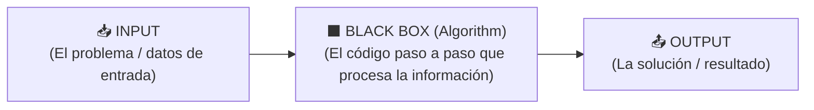

# 🎓 CS50x 2026 — Week 0: Scratch & Computational Thinking

> **Profesor:** David J. Malan (Harvard University)  
> **Última sesión:** `08/10/2026` · **Progreso actual:** `00:00` → [`29:54` (`start=1794`)](https://video.cs50.io/UuIEbpQms8o?start=1794) *(Pausado justo al empezar **ASCII**)*  
> **Links rápidos:** [📺 Video Oficial (Retomar en 29:54)](https://video.cs50.io/UuIEbpQms8o?start=1794) · [📄 Lecture 0 Notes](https://cs50.harvard.edu/x/2026/notes/0/) · [🧩 Problem Set 0](https://cs50.harvard.edu/x/2026/psets/0/)

---

## ⚡ Inbox de Captura Rápida (Tus Keywords en Vivo)

> [!TIP]
> **Flujo de estudio sin perder ritmo:** Mientras mirás el video, **solo tirá acá abajo tus palabras clave o frases sueltas** (como hiciste el jueves). Cuando terminás tu bloque, me decís *"Tyler, actualizame el apunte"* y yo:
> 1. Agrego los términos nuevos a la **Tabla de Contenidos / Glosario** de abajo.
> 2. Redacto y diseño los **capítulos visuales completos** (con diagramas, tablas de bits, bloques de código y ejemplos de la clase) en la segunda mitad del documento.

- *(Anotá acá tus próximas palabras clave a partir del minuto `29:54` — ASCII, Unicode, RGB, Algorithms...)*
- 

---

## 📑 1. Índice del Apunte & Tabla Maestra de Conceptos (`00:00` → `29:54`)

### Navegación por Capítulos del Apunte Visual
1. [🚀 Welcome, AI & `chat.py` (Min. `00:00` – `14:25`)](#-capítulo-1-welcome-ai--tu-primer-chatbot-en-python-0000--1425)
2. [🧠 Computer Science & Problem Solving (Min. `14:27` – `15:38`)](#-capítulo-2-qué-es-computer-science--computational-thinking-1427--1538)
3. [✋ De Unary (`Base-1`) a Binary (`Base-2`) y Transistores (Min. `15:39` – `21:31`)](#-capítulo-3-unary-vs-binary-bits-y-transistores-1539--2131)
4. [🔢 Cómo Cuentan las Computadoras: `Base-10` vs. `Base-2` (Min. `21:32` – `26:25`)](#-capítulo-4-matemática-posicional-decimal-base-10-vs-binario-base-2-2132--2625)
5. [📦 Qué es un `Byte` (`8 Bits`) y por qué llega a `256` (Min. `26:26` – `29:54`)](#-capítulo-5-el-byte-8-bits-y-el-límite-de-256-combinaciones-2626--2954)
6. [🎯 Autochequeo Rápido (Flash Review hasta min. `29:54`)](#-autochequeo-rápido-flash-review-0000--2954)

### Glosario Rápido con Timestamp Directo

| Content / Term | Meaning (Core Definition) | Video Timestamp |
| :--- | :--- | :---: |
| **AI & Fundamentals** | AI eliminates human bottlenecks, but mastering fundamentals makes you the **driver/pilot** of code. | [02:25](https://video.cs50.io/UuIEbpQms8o?start=145) |
| **IDE (`VS Code`)** | *Integrated Development Environment*: the workspace (editor + terminal) where programmers write and run code. | [04:48](https://video.cs50.io/UuIEbpQms8o?start=288) |
| **API** | *Application Programming Interface*: mechanism to connect your code to third-party services (like OpenAI's `gpt-5`). | [06:23](https://video.cs50.io/UuIEbpQms8o?start=383) |
| **Rubber Duck Debugging** | Explaining your code line by line out loud to a rubber duck (`cs50.ai`) to uncover your own logic bugs. | [12:30](https://video.cs50.io/UuIEbpQms8o?start=750) |
| **Computer Science** | **The study of information** (how to represent it and how to process it) to solve problems. | [14:27](https://video.cs50.io/UuIEbpQms8o?start=867) |
| **Computational Thinking** | Applying ideas from computer science to solve real-world problems methodically. | [14:31](https://video.cs50.io/UuIEbpQms8o?start=871) |
| **Unary Notation (`Base-1`)** | Counting system with only **1 symbol** (e.g., human fingers where each raised finger simply adds $+1$). | [15:39](https://video.cs50.io/UuIEbpQms8o?start=939) |
| **Binary System (`Base-2`)** | Counting system with **2 digits (`0` and `1`)**, matching physical electricity (`OFF` and `ON`). | [16:09](https://video.cs50.io/UuIEbpQms8o?start=969) |
| **Bit (`Binary Digit`)** | Contraction of **bi**nary digi**t**: a single `0` or `1` (the smallest unit of data in computing). | [17:49](https://video.cs50.io/UuIEbpQms8o?start=1069) |
| **Transistors** | Microscopic physical switches inside CPUs/memory (millions/billions of "tiny light bulbs") that turn `ON` (`1`) or `OFF` (`0`). | [19:27](https://video.cs50.io/UuIEbpQms8o?start=1167) |
| **Decimal System (`Base-10`)** | Human counting system with **10 digits (`0` → `9`)** using powers of 10 ($10^0, 10^1, 10^2 \dots$). | [21:32](https://video.cs50.io/UuIEbpQms8o?start=1292) / [23:00](https://video.cs50.io/UuIEbpQms8o?start=1380) |
| **Binary Powers ($2^n$)** | Positional columns in Base-2 use **powers of 2** ($2^0=1,\, 2^1=2,\, 2^2=4,\, 2^3=8 \dots$) because there are only 2 symbols. | [23:42](https://video.cs50.io/UuIEbpQms8o?start=1422) |
| **Integer Overflow (3 bits)** | Running out of bits: if you only have 3 bits (max `111` = $7$) and try to count `8` (`1000`), the 3 bits roll back to `000`. | [25:26](https://video.cs50.io/UuIEbpQms8o?start=1526) |
| **Byte (`8 Bits`)** | Standard unit of **8 bits grouped together** ($1\text{ Byte} = 8\text{ Bits}$). | [26:26](https://video.cs50.io/UuIEbpQms8o?start=1586) |
| **$8\text{ Bits} = 2^8 = 256$** | One byte (`8 bits`) can represent **$256$ possible values**: from `0` (`00000000`) up to `255` (`11111111`). | [27:11](https://video.cs50.io/UuIEbpQms8o?start=1631) / [27:42](https://video.cs50.io/UuIEbpQms8o?start=1662) |

---
---

# 📖 2. Apunte Visual Desarrollado (Clase 0 — Paso a Paso)

---

## 🚀 Capítulo 1: Welcome, AI & Tu Primer Chatbot en Python (`00:00` – `14:25`)

### 1.1. La IA no reemplaza los fundamentos: te convierte en el Piloto ([02:25](https://video.cs50.io/UuIEbpQms8o?start=145))
David Malan arranca explicando por qué aprender **Computer Science** desde cero sigue siendo decisivo en la era de la Inteligencia Artificial:
- La IA elimina los **cuellos de botella humanos** (*human bottlenecks*), pero si no entendés qué hace el código por debajo, sos un pasajero a ciegas.
- Dominar los fundamentos te convierte en el **conductor / piloto** (*the driver, the pilot*): usás la IA como multiplicador de fuerza mientras vos diseñás y controlás el sistema.

### 1.2. Demo en vivo: VS Code + OpenAI API en 10 líneas (`chat.py`) ([04:48](https://video.cs50.io/UuIEbpQms8o?start=288))
Antes de bajar a los bits, Malan muestra hacia dónde va el curso construyendo un chatbot real en **Visual Studio Code** (un **IDE** — *Integrated Development Environment*) que se conecta a la **API** (*Application Programming Interface*) de OpenAI en tres pasos evolutivos:

#### Paso A — Pregunta fija (*Hardcoded Input*)
```python
from openai import OpenAI

client = OpenAI()

response = client.responses.create(
    input="In one sentence, what is CS50?",
    model="gpt-5"
)

print(response.output_text)
```

#### Paso B — Pregunta interactiva del usuario (`input()`) + `system_prompt` ([08:26](https://video.cs50.io/UuIEbpQms8o?start=506) – [10:36](https://video.cs50.io/UuIEbpQms8o?start=636))
Para que el programa no responda siempre lo mismo, se guarda lo que escribe el usuario en la variable `user_prompt` y se le da personalidad con `system_prompt`:

```python
from openai import OpenAI

client = OpenAI()

user_prompt = input("Prompt: ")
system_prompt = "Limit your answer to one sentence. Pretend you're a cat."

response = client.responses.create(
    input=user_prompt,
    instructions=system_prompt,
    model="gpt-5"
)

print(response.output_text)
```

### 1.3. Rubber Duck Debugging & el Pato Oficial de CS50 (`cs50.ai`) ([12:30](https://video.cs50.io/UuIEbpQms8o?start=750))
> [!IMPORTANT]
> **¿Qué es *Rubber Duck Debugging*?**  
> Cuando tenés un error (*bug*) en tu código y no tenés a quién preguntarle, tener un **pato de goma** en el escritorio y explicarle en voz alta, línea por línea, qué se supone que hace tu programa hace que tu propio cerebro escuche la contradicción lógica y descubra el error solo.
>
> **Regla de Honestidad Académica de CS50x:** Está **prohibido** usar ChatGPT, Gemini o Claude para resolver los *Problem Sets* del curso, pero está **100% permitido y recomendado** usar [**`cs50.ai` (CS50 Duck)**](https://cs50.ai/), la IA oficial entrenada por Harvard que te guía como un tutor sin regalarte la respuesta hecha.

---

## 🧠 Capítulo 2: ¿Qué es Computer Science & Computational Thinking? (`14:27` – `15:38`)

En el minuto [`14:27`](https://video.cs50.io/UuIEbpQms8o?start=867), Malan define el corazón de toda la materia con dos conceptos fundamentales que vos anotaste en vivo:

- **Computer Science (*Ciencia de la Computación*):** Es el **estudio de la información** (*the study of information*) — cómo representarla y cómo procesarla — aplicado a **resolver problemas** (*problem-solving*).
- **Computational Thinking (*Pensamiento Computacional*):** Es aplicar las ideas y la lógica de la ciencia de la computación a problemas de la vida real o de cualquier disciplina.

### El Modelo Universal de Resolución de Problemas (`Input → Algorithm → Output`) ([14:59](https://video.cs50.io/UuIEbpQms8o?start=899))

Todo problema en informática se reduce a tres partes:



> [!NOTE]
> **La primera pregunta del curso:** Antes de poder meter datos en el `INPUT` o sacar resultados en el `OUTPUT`, **¿cómo acordamos representar la información (números, letras, colores, imágenes, audio) adentro de una máquina que solo tiene electricidad?**

---

## ✋ Capítulo 3: Unary vs. Binary, Bits y Transistores (`15:39` – `21:31`)

### 3.1. Unary Notation (`Base-1`) — Contar con los dedos a lo humano ([15:39](https://video.cs50.io/UuIEbpQms8o?start=939))
Cuando contamos personas en un aula con una mano de forma tradicional, usamos el **sistema unario (`Base-1`)**:
- Tenemos **un único símbolo** (un dedo levantado = $+1$).
- Con **5 dedos** en una mano, solo podemos contar como máximo hasta **`5`** (`1, 2, 3, 4, 5`), porque no importa el orden en que levantes los dedos: cada dedo vale siempre `1`.

### 3.2. Binary System (`Base-2`) — Por qué las computadoras cuentan distinto ([16:09](https://video.cs50.io/UuIEbpQms8o?start=969))
Si en vez de darle a cada dedo el valor fijo de `1`, tenemos en cuenta el **patrón exacto de qué dedos están abajo (`0`) y cuáles están arriba (`1`)**, pasamos al **sistema binario (`Base-2`)**:
- Con los mismos **5 dedos** de una sola mano, ya no estás limitado a contar hasta `5`: podés contar desde **`0` hasta `31`** ($2^5 = 32$ combinaciones distintas).

| Sistema | Nombre en inglés | Símbolos disponibles | Máximo con 5 dedos |
| :--- | :--- | :---: | :---: |
| **Unario (`Base-1`)** | *Unary notation* | `1` solo símbolo (marca/dedo) | **Hasta `5`** |
| **Binario (`Base-2`)** | *Binary system* | `2` símbolos (`0` y `1`) | **Hasta `31`** ($32$ estados contando el `0`) |

### 3.3. ¿Qué es un `Bit` y por qué existen los `Transistors`? ([17:49](https://video.cs50.io/UuIEbpQms8o?start=1069) – [19:27](https://video.cs50.io/UuIEbpQms8o?start=1167))

- **`Bit` = `Bi`nary Digi`t` (*Dígito Binario*):** Es la unidad mínima de información en computación. Solo puede valer **`0`** o **`1`**.
- **¿Por qué las computadoras usan `0` y `1` en vez de `0` al `9`?**  
  Porque lo único que enchufamos a la pared o guardamos en una batería es **electricidad** (electrones fluyendo). Físicamente es muchísimo más fácil y confiable distinguir dos estados extremos: **no pasa corriente (`OFF = 0`)** o **sí pasa corriente (`ON = 1`)**.
- **La analogía de las lamparitas y los `Transistors` ([19:27](https://video.cs50.io/UuIEbpQms8o?start=1167)):**
  > *"Computers don't have little light bulbs inside, but they have millions (and billions) of tiny little switches called **transistors**."*  
  Adentro de tu CPU, de tu memoria RAM o de tu teléfono hay miles de millones de interruptores microscópicos llamados **transistores**:

| Estado físico del Transistor | Metáfora de la Lamparita | Valor del Bit |
| :---: | :---: | :---: |
| **Sin corriente / Apagado** | ⚫ `OFF` | **`0`** |
| **Con corriente / Encendido** | 💡 `ON` | **`1`** |

---

## 🔢 Capítulo 4: Matemática Posicional: Decimal (`Base-10`) vs. Binario (`Base-2`) (`21:32` – `26:25`)

Con **1 sola lamparita (1 bit)** solo podés representar dos cosas: `0` (⚫) o `1` (💡). ¿Cómo hacés para contar hasta `2`, `3`, `7` o más? **Usando múltiples bits y dándole un peso posicional a cada columna**, igual que hacemos en matemática desde la primaria.

### 4.1. Cómo funciona nuestro sistema humano: Decimal (`Base-10`) ([21:32](https://video.cs50.io/UuIEbpQms8o?start=1292) – [23:00](https://video.cs50.io/UuIEbpQms8o?start=1380))
En el sistema decimal tenemos **10 dígitos (`0, 1, 2, 3, 4, 5, 6, 7, 8, 9`)**.  
Por eso, cuando escribís en pizarra los símbolos `1`, `2`, `3`, tu cerebro no ve tres dígitos sueltos: ve **ciento veintitrés ($123$)** porque cada columna es una **potencia de base 10** ($10^2, 10^1, 10^0$):

| Potencia de 10 | $10^2$ *(Centenas)* | $10^1$ *(Decenas)* | $10^0$ *(Unidades)* | Cálculo total |
| :---: | :---: | :---: | :---: | :--- |
| **Peso de la columna** | **`100`** | **`10`** | **`1`** | |
| **Dígitos de `123`** | `1` | `2` | `3` | $(100 \times 1) + (10 \times 2) + (1 \times 3) = \mathbf{123}$ |

### 4.2. Cómo funciona el sistema de la computadora: Binario (`Base-2`) ([23:42](https://video.cs50.io/UuIEbpQms8o?start=1422))
Las computadoras usan exactamente la misma lógica posicional, pero como **solo tienen 2 símbolos (`0` y `1`)**, en vez de potencias de $10$ usan **potencias de $2$** ($2^2, 2^1, 2^0 \dots$):

| Potencia de 2 | $2^2$ | $2^1$ | $2^0$ |
| :---: | :---: | :---: | :---: |
| **Peso de la columna** | **`4`** | **`2`** | **`1`** |

Mirá cómo se arman todos los números del **`0` al `7`** usando **3 lamparitas (3 bits)**:

| Columna `4` ($2^2$) | Columna `2` ($2^1$) | Columna `1` ($2^0$) | Estado de las 3 Lamparitas | Suma Posicional | Número Decimal |
| :---: | :---: | :---: | :---: | :--- | :---: |
| `0` | `0` | `0` | ⚫ ⚫ ⚫ | $0 + 0 + 0$ | **`0`** |
| `0` | `0` | `1` | ⚫ ⚫ 💡 | $0 + 0 + 1$ | **`1`** |
| `0` | `1` | `0` | ⚫ 💡 ⚫ | $0 + 2 + 0$ | **`2`** |
| `0` | `1` | `1` | ⚫ 💡 💡 | $0 + 2 + 1$ | **`3`** |
| `1` | `0` | `0` | 💡 ⚫ ⚫ | $4 + 0 + 0$ | **`4`** |
| `1` | `0` | `1` | 💡 ⚫ 💡 | $4 + 0 + 1$ | **`5`** |
| `1` | `1` | `0` | 💡 💡 ⚫ | $4 + 2 + 0$ | **`6`** |
| `1` | `1` | `1` | 💡 💡 💡 | $4 + 2 + 1$ | **`7`** *(Máximo con 3 bits)* |

### 4.3. ¿Qué pasa si querés representar el `8`? (Necesitás un 4º bit o sufrís *Overflow*) ([25:26](https://video.cs50.io/UuIEbpQms8o?start=1526))
- Con 3 bits prendidos al máximo (`111`), llegaste a **`7`**, que nos da **$8$ combinaciones totales** ($2^3 = 8$, contando del `0` al `7`).
- Para representar el número **`8`**, necesitás agregar una cuarta columna a la izquierda ($2^3 = 8$), quedando **`1000`** (`8 + 0 + 0 + 0 = 8`).
- ⚠️ **Error clásico en programación (*Overflow*):** Si la computadora solo reservó **3 bits de memoria** y le sumás `1` al `7` (`111`), el `1` de la columna del `8` no tiene dónde guardarse, se pierde, y las 3 lamparitas quedan en **`000` (vuelve a `0` por error)**.

---

## 📦 Capítulo 5: El `Byte` (`8 Bits`) y el Límite de `256` Combinaciones (`26:26` – `29:54`)

Como 1 solo bit o 3 bits se quedan cortos enseguida, la unidad estándar en todas las computadoras es el **Byte**:

$$\mathbf{1\text{ Byte} = 8\text{ Bits}}$$

### 5.1. La Grilla Visual de 1 Byte (Las 8 columnas de potencias de 2)
Cada byte tiene **8 casillas**, que van desde $2^0 = 1$ (derecha) hasta $2^7 = 128$ (izquierda):

| Potencia | $2^7$ | $2^6$ | $2^5$ | $2^4$ | $2^3$ | $2^2$ | $2^1$ | $2^0$ | Valor Decimal |
| :--- | :---: | :---: | :---: | :---: | :---: | :---: | :---: | :---: | :---: |
| **Peso de columna** | **`128`** | **`64`** | **`32`** | **`16`** | **`8`** | **`4`** | **`2`** | **`1`** | — |
| **Mínimo (`Todo OFF`)** | `0` | `0` | `0` | `0` | `0` | `0` | `0` | `0` | **`0`** |
| **Ejemplo: Número `5`** | `0` | `0` | `0` | `0` | `0` | `1` | `0` | `1` | **`5`** ($4 + 1$) |
| **Máximo (`Todo ON`)** | `1` | `1` | `1` | `1` | `1` | `1` | `1` | `1` | **`255`** ($128+64+32+16+8+4+2+1$) |

### 5.2. La Regla de Oro que anotaste: `8 Bits = 256 (2^8)` ([27:11](https://video.cs50.io/UuIEbpQms8o?start=1631) – [27:42](https://video.cs50.io/UuIEbpQms8o?start=1662))

> [!IMPORTANT]
> **¿Por qué el número más alto de 1 Byte es `255`, pero hay `256` posibilidades?**  
> - Porque empezamos a contar desde el **`0`** (`00000000`), no desde el `1`.
> - Matemáticamente: con $n$ bits tenés **$2^n$ combinaciones totales**, y el número máximo representable (si empezás en $0$) es **$2^n - 1$**:
>   - **3 bits:** $2^3 = \mathbf{8}$ combinaciones $\rightarrow$ cuenta del **`0` al `7`**.
>   - **8 bits (1 Byte):** $2^8 = \mathbf{256}$ combinaciones $\rightarrow$ cuenta del **`0` al `255`**.
>   - **32 bits (4 Bytes):** $2^{32} \approx \mathbf{4.000.000.000}$ ($\sim 4\text{ billion}$ combinaciones).
>   - **64 bits (8 Bytes):** $2^{64} \approx \mathbf{1,84 \times 10^{19}}$ combinaciones.

---

## 🎯 Autochequeo Rápido (Flash Review `00:00` → `29:54`)

<details>
<summary><b>1. ¿Qué número decimal representa el byte <code>00001011</code>?</b> <i>(Click para ver respuesta)</i></summary>

Mirando las 4 últimas columnas (`8 | 4 | 2 | 1`): tenés prendidos el `8`, el `2` y el `1` $\rightarrow$ $8 + 2 + 1 = \mathbf{11}$.
</details>

<details>
<summary><b>2. ¿Por qué 8 bits dan 256 combinaciones pero el número más alto es 255?</b> <i>(Click para ver respuesta)</i></summary>

Porque una de las $2^8 = 256$ combinaciones se usa para representar el **`0`** (`00000000`). Por lo tanto, el rango va de `0` a `255` ($2^8 - 1$).
</details>

<details>
<summary><b>3. ¿Qué diferencia física hay entre un Bit y un Transistor?</b> <i>(Click para ver respuesta)</i></summary>

El **Transistor** es el componente físico real (el interruptor microscópico de silicio dentro del chip que deja pasar o corta la electricidad). El **Bit** (`0` o `1`) es el valor lógico de información que ese transistor representa cuando está apagado (`0`) o encendido (`1`).
</details>

---

## 🔜 Próxima Parada en el Video ([Minuto `29:54` — ASCII](https://video.cs50.io/UuIEbpQms8o?start=1794))

Justo donde dejaste pausado el video, Malan muestra en pantalla la letra **`A`** y pregunta:
> *"How can the computer store a capital letter A if all we have are zeros and ones?"*

En tus próximos 20–30 minutos vas a ver:
1. **ASCII (`29:54`):** Cómo la letra `A` se guarda como el número `65` (`01000001`) y el mensaje `HI!` son 3 bytes (`72`, `73`, `33`).
2. **Unicode:** Cómo pasamos de 8 bits a 16/32 bits para soportar todos los idiomas del mundo y los **emojis** (y por qué los tonos de piel de un emoji son varios códigos combinados).
3. **RGB (`Red, Green, Blue`):** Cómo cada píxel de tu pantalla usa **3 bytes** (uno para rojo, uno para verde, uno para azul, de `0` a `255` cada uno).
4. **Algorithms & Big-O (El ejemplo de la Guía Telefónica)** + **Pseudocode** + **Scratch**.

---

<details>
<summary>🗄️ Ver respaldo literal de tus apuntes originales del 08/10/2026 (Recuperados de <code>zT3r.md</code>)</summary>

```markdown
# Week 0 — Scratch

08/10/2026
Today i've watched the video up to the minute : "https://video.cs50.io/UuIEbpQms8o?start=1794"

## Table of contents

| Content          |       Meaning        |                                        Time |
| :--------------- | :------------------: | ------------------------------------------: |
| Computer Science | Study of information | https://video.cs50.io/UuIEbpQms8o?start=867 |

### Lista a agregar (Tyler debes formatear todo mejor entendiendo que quiero hacer.)

- Computational thinking 14.35
- Unary notation and binary = Base-1 and base-2 systems
- Binary digit ---<> BIT
- Computers dosn't have little bulbs inside, but they have millions of tiny little things called transitors
- Base-10 System = Decimal system (Ten digits: 0 -->9) 10 to 1, 10 to 2, etc
- Binary = 2 to 0, 2 to 1, 2 to 2, etc (Because we only have 2 symbols)
- 8 BITS = 1 Byte
- 8 bites = 256 (2 to 8)
-

Tyler si lees esto, necesito ayuda para ver como ir haciendo este documenbto, y que debop agregar a medida que avanzo con el video de la week 0, que agregar, como hacerlo, con que formato, y que no y decime y explicame todo.
Capaz conviene crear un solo archivo.md para la table of contents aparte. Yo voy a ir anotantdo palabras claves para no perder la velocidad con el curso ya que es largo, pero luego tu deberás completar las definiciones, y todo.
```

</details>
